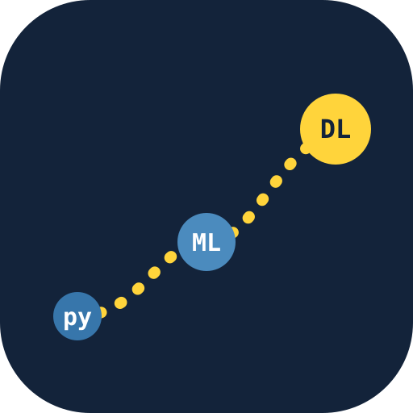

<div align="center">



# Python → ML → Deep Learning: My Learning Journey

**My own exercise solutions and experiments from learning machine learning and deep learning, from linear regression to CNNs.**


</div>

---

## About

I learned ML by following the **[codebasics](https://www.youtube.com/@codebasics)** machine-learning and deep-learning courses, coding along and then solving every exercise **on my own before looking at the answer**.

This repo contains **only my work**: my exercise solutions, my re-attempts and my extra experiments. The original course notebooks and datasets belong to codebasics and live in their repos ([py](https://github.com/codebasics/py), [deep-learning-keras-tf-tutorial](https://github.com/codebasics/deep-learning-keras-tf-tutorial)). Where I edited one of their notebooks, it's included and marked as such.

## 01 · Machine learning (scikit-learn)

| Topic | My work | Highlights |
|---|---|---|
| Linear regression | [solution](01-machine-learning/01-linear-regression/exercise_solution.ipynb) · [second attempt](01-machine-learning/01-linear-regression/exercise_solution_second_attempt.ipynb) | Canada per-capita income. Re-solved from scratch a second time to make it stick |
| Multivariate regression | [solution](01-machine-learning/02-multivariate-regression/exercise_solution.ipynb) | Hiring dataset: filling missing values, multiple features |
| Gradient descent | [notebook](01-machine-learning/03-gradient-descent/exercise_solution.ipynb) · [script](01-machine-learning/03-gradient-descent/gradient_descent_practice.py) | Test-scores dataset, checked against sklearn's `LinearRegression` |
| Train/test split | [practice](01-machine-learning/06-train-test-split/train_test_split_practice.ipynb) | Car prices |
| Logistic regression | [my solution](01-machine-learning/07-logistic-regression/my_solution.ipynb) · [HR retention](01-machine-learning/07-logistic-regression/hr_retention_exercise.ipynb) *(edited)* | HR employee retention: EDA → feature selection → model |
| Multiclass logistic regression | [my solution](01-machine-learning/08-multiclass-logistic-regression/my_solution.ipynb) | Iris and digits, confusion matrix |
| Decision tree | [my solution](01-machine-learning/09-decision-tree/my_solution.ipynb) · [script](01-machine-learning/09-decision-tree/decision_tree_practice.py) | Titanic survival |
| Naive Bayes | [my solution](01-machine-learning/14-naive-bayes/my_solution.ipynb) · [practice](01-machine-learning/14-naive-bayes/naive_bayes_practice.ipynb) | `Pipeline`, Gaussian vs Multinomial |
| Grid search | [GridSearchCV](01-machine-learning/15-grid-search/grid_search_cv.ipynb) *(edited)* · [exercise](01-machine-learning/15-grid-search/exercise_solution.ipynb) | Choosing model and hyper-parameters together |
| L1 / L2 regularization | [my solution](01-machine-learning/16-regularization/my_solution.ipynb) | Lasso vs Ridge on Melbourne housing |
| PCA | [digits demo](01-machine-learning/18-pca/pca_digits_demo.ipynb) · [exercise](01-machine-learning/18-pca/exercise_solution.ipynb) · [heart disease](01-machine-learning/18-pca/heart_disease_pca.ipynb) *(edited)* | Dimensionality reduction before classification |
| Bagging | [my solution](01-machine-learning/19-bagging/my_solution.ipynb) · [heart disease](01-machine-learning/19-bagging/heart_disease_bagging.ipynb) *(edited)* | Bagging vs a single tree |

## 02 · Deep learning (TensorFlow / Keras)

| Topic | My work |
|---|---|
| Digits recognition (ANN) | [MNIST practice](02-deep-learning/01-digits-recognition/mnist_practice.ipynb) |
| Matrix math for NNs | [practice](02-deep-learning/04-matrix-math/matrix_math_practice.ipynb) |
| GPU vs CPU benchmarking | [my solution](02-deep-learning/10-gpu-benchmarking/my_solution.ipynb): Fashion-MNIST timing on both devices |
| Customer churn (ANN) | [course notebook, edited](02-deep-learning/11-churn-prediction/churn_ann.ipynb) · [my version](02-deep-learning/11-churn-prediction/churn_my_version.ipynb) |
| CNN on CIFAR-10 | [course notebook, edited](02-deep-learning/16-cnn-cifar10/cnn_cifar10.ipynb) · [ANN vs CNN timing](02-deep-learning/16-cnn-cifar10/ann_vs_cnn_timing.ipynb) |
| Data augmentation | [flowers, edited](02-deep-learning/17-data-augmentation/flowers_augmentation.ipynb) · [my version](02-deep-learning/17-data-augmentation/flowers_my_version.ipynb) |

## 03 · Experiments

| Experiment | What |
|---|---|
| [Audio EDA](03-experiments/audio-preprocessing-ravdess/audio_eda_librosa.ipynb) | Loading and visualizing the **RAVDESS** emotional speech dataset with `librosa`: waveforms, sample rates, batch loading |
| [Shadow and highlight correction](03-experiments/shadow-highlight-correction/shadow_highlight_correction.ipynb) | Image tone correction with OpenCV |
| [FastAPI basics](03-experiments/fastapi-basics/main.py) | First REST endpoints with path parameters and `Enum` validation |

## Run

```bash
pip install numpy pandas matplotlib seaborn scikit-learn tensorflow librosa opencv-python jupyter fastapi uvicorn
jupyter lab
```

Datasets aren't included. Get them from the matching codebasics folder or from Kaggle (the notebook names the dataset).

## Where this led

- 🧪 [tensorflow-tutorial-labs](https://github.com/humamaldhubhani/tensorflow-tutorial-labs): audio and video deep learning.
- 🌱 [plant-disease-classifier](https://github.com/humamaldhubhani/plant-disease-classifier): an end-to-end CNN with an API and a web app.
- 🔬 [deepfake-detection-celeb-df](https://github.com/humamaldhubhani/deepfake-detection-celeb-df): my own multi-branch deepfake detector.

## Author

**Humam Al-Dhubhani** · [GitHub](https://github.com/humamaldhubhani)

<sub>My code is released under the [MIT License](LICENSE). Course material © codebasics.</sub>
